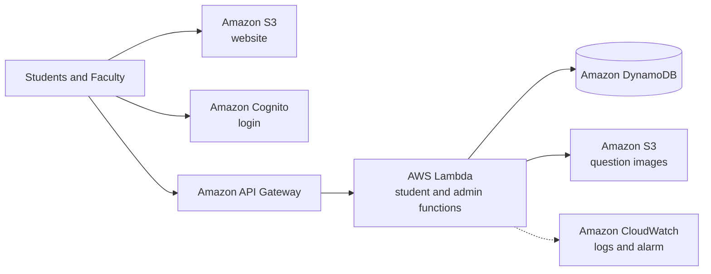

# Cloud-Based Online Quiz Portal using AWS

Cloud Computing course project, Lab L202 (Friday 1:50 PM). Faculty Advisor: Samya Muri.

| Team member | Roll No. |
|---|---|
| Sanchita Jain | 1024031020 |
| Lakshay Gambhir | 1024031026 |
| Rachita Arora | 1024030967 |

## Abstract

A simple online quiz portal for students and faculty. Students register, attempt timed quizzes and see their scores once faculty publish them. Faculty create and manage quizzes, questions and durations, and view all student results. The portal is built entirely from AWS managed services, and shows how they can be combined into a secure, scalable web application that runs within the AWS Free Tier.

## Features

- Student registration with email verification, and login for students and faculty
- Creation and management of quizzes
- Multiple-choice questions with optional images
- Timed quizzes: answers are saved as they are chosen, and the quiz submits automatically when time runs out
- Automatic evaluation of answers
- Results shown to students when faculty publish them
- Quiz and result data stored in the cloud
- Faculty view of all results, with CSV download

## AWS Architecture



| Service | Use |
|---|---|
| Amazon S3 | Hosts the website, and stores question images in a private bucket |
| Amazon Cognito | Registration, login, password reset, and the faculty (Admin) role |
| Amazon API Gateway | REST API that checks the login token on every request |
| AWS Lambda | Backend logic, in two functions with separate permissions for students and faculty |
| Amazon DynamoDB | Quizzes, questions and results |
| Amazon CloudWatch | Logs, and an email alarm on API errors |
| AWS SAM | Creates all of the above from one template |

## Tech stack

- **Frontend:** React (Vite), plain CSS
- **Backend:** Node.js 24 on AWS Lambda, AWS SDK v3
- **Region:** ap-south-1 (Mumbai)

## Project structure

```
backend/
  template.yaml      AWS resources (SAM)
  src/               routes, controllers, services, models, utils
frontend/
  src/               pages, components, services
scripts/
  create-admin.sh    creates a faculty account
```

## Deployment

```bash
# Backend
cd backend
sam build
sam deploy --stack-name quiz-portal --region ap-south-1 --resolve-s3 \
  --capabilities CAPABILITY_IAM --parameter-overrides AlertEmail=you@example.com

# Frontend (copy .env.example to .env and fill in the stack outputs first)
cd ../frontend
npm install
npm run build
aws s3 sync dist s3://<WebsiteBucket> --delete

# Faculty account
cd ..
./scripts/create-admin.sh faculty@example.com "Faculty Name"
```
